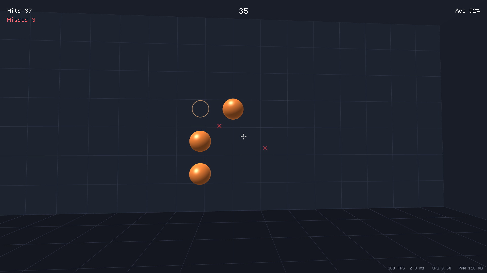
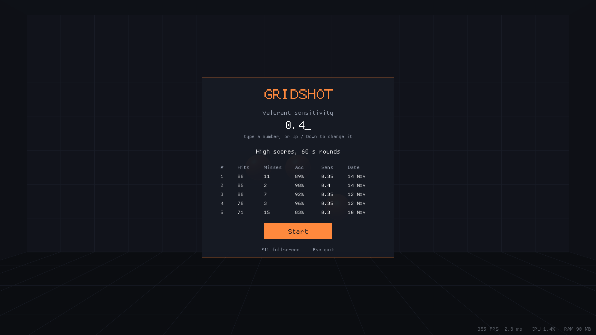
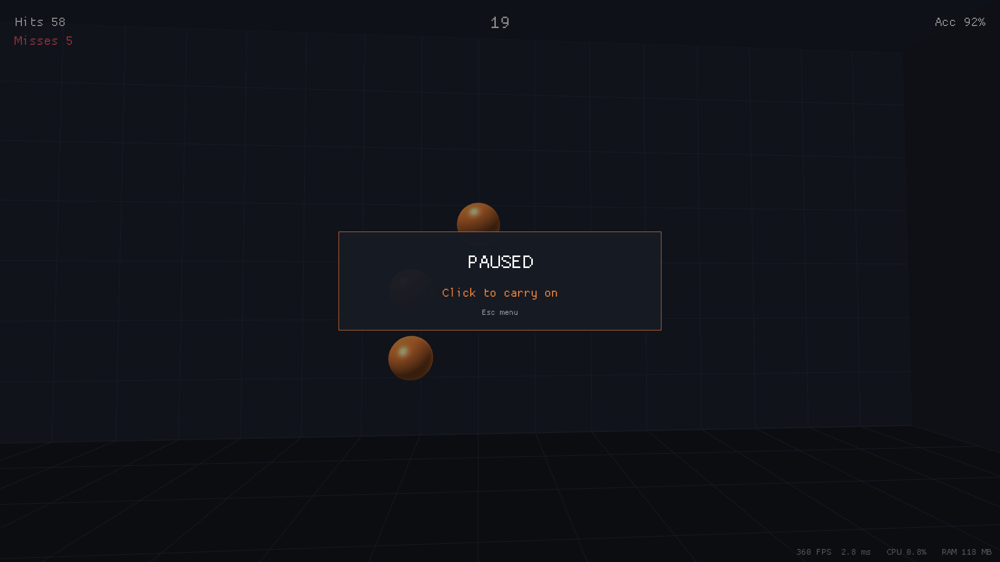
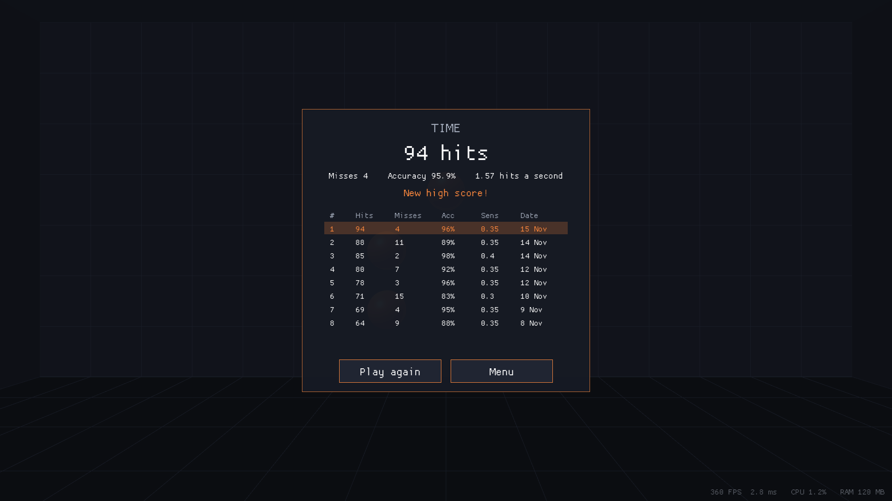

# Gridshot

A tiny, native Windows aim trainer. There are nine spots in a 3×3 grid and three
targets are up at a time. Shoot one and a new target appears in a random free spot.
You get 60 seconds to hit as many as you can.

Mouse look uses your **Valorant sensitivity**, so practice here feels the same as in game.
It's one **0.7 MB exe** with no installer, no launcher and no account.



## Features

- **The classic grid drill:** 9 spots, 3 live targets, and a new target never appears in the
  spot you just shot.
- **True Valorant sensitivity:** Gridshot reads raw mouse counts (Windows raw input, no
  acceleration) and turns 0.07° per count × sensitivity, the same as Valorant. The field of
  view is Valorant's 103° horizontal at 16:9, so targets look the same size too.
- **Misses you can see:** a live miss counter, and a red ✕ where each missed shot landed.
- **High scores:** your top 10 rounds, with hits, misses, accuracy, sensitivity and date.
- **Pause on Alt+Tab:** pressing the Windows key or Alt+Tab pauses the round and frees your
  mouse. Click the game to carry on.
- **Fullscreen or windowed:** F11 or Alt+Enter switches, and the game remembers your choice.
- **FPS, CPU and RAM meter** in the corner, so you can see how little it uses.

## Screenshots

| Menu | Playing |
| --- | --- |
|  |  |
| **Paused** | **Results** |
|  |  |

## How lightweight is it?

These numbers come from a 30-second round that the game played by itself
(`tools/measure.ps1`). It ran fullscreen at 1920×1080 with vsync on, on an
i7-12700F, an RTX 3060 and a 360 Hz monitor.

| | Gridshot |
| --- | --- |
| Download size | **0.74 MB** (one exe, no other files) |
| Frame rate | 360 FPS (locked to the monitor), 2.8 ms a frame |
| CPU | **0.5 %** average, 1.2 % peak (share of all 20 threads, as Task Manager shows it) |
| RAM (working set) | **~45 MB** average, 84 MB peak during start-up |
| GPU | **~3.4 %** |

Run `tools\measure.ps1` to measure it on your own PC. The in-game meter in the bottom-right
corner shows the same FPS, CPU and RAM numbers live.

## Download and play

1. Download `gridshot.exe` from the [Releases](../../releases) page, or build it yourself (below).
2. Double-click it. Windows SmartScreen may warn you because the exe isn't signed: click
   **More info → Run anyway**.
3. Type your Valorant sensitivity on the menu and click **Start**.

### Controls

| Key | Action |
| --- | --- |
| **Start** / **Play again** button | Start a round. The end screen waits a second before its buttons work, so leftover clicks don't start a new round. |
| Left click | Shoot |
| Esc | Leave the round, or quit from the menu |
| Windows key, Alt+Tab | Pause the round and free the mouse; click the game to carry on |
| F11, Alt+Enter | Toggle fullscreen |
| Up / Down (hold Shift for ×10) | Change sensitivity on the menu |

### Settings and scores

Everything is saved in `%APPDATA%\gridshot\`:

`settings.txt`

```
sensitivity=0.35
fullscreen=false
vsync=true        # false = uncapped frame rate, less input lag (read at start-up)
duration=60       # round length in seconds
volume=0.5
```

`scores.txt` keeps the top 10 rounds for each round length, ranked by hits and then by
fewer misses.

## Build

You need [Rust](https://rustup.rs) with the MSVC toolchain (Visual Studio Build Tools).

```
cargo build --release      # target\release\gridshot.exe
cargo test
```

From WSL, `./build.sh` builds with the Windows toolchain and copies the exe to `dist/`.
`./build.sh shots` also saves fresh screenshots to `docs/screenshots`.

### Demo modes

Two scripted modes need no mouse or keyboard, and never save settings or scores:

- `GRIDSHOT_DEMO=shots` draws each screen with sample data, saves the screenshots in
  `docs/screenshots`, then quits.
- `GRIDSHOT_DEMO=bench:30` plays a 30-second round by itself, flicking to targets and
  shooting. `tools/measure.ps1` uses it.

## How it works

Gridshot is written in Rust on [macroquad](https://github.com/not-fl3/macroquad), a small
OpenGL game library. There are no assets: the font is built in, the hit sound is generated
in code and the targets are lit with a tiny shader.

| File | What it does |
| --- | --- |
| `src/game.rs` | Grid, spawning, hit testing and the Valorant mouse maths (unit tested) |
| `src/main.rs` | Window, input, game loop and drawing |
| `src/scores.rs` | High score table (unit tested) |
| `src/settings.rs` | Settings file (unit tested) |
| `src/usage.rs` | The CPU and RAM meter |
| `src/demo.rs` | Screenshot and benchmark modes |
| `src/sound.rs` | The generated hit sound |

## License

[MIT](LICENSE)

Gridshot is a fan-made practice tool. It is not affiliated with Riot Games or Aim Lab.
VALORANT is a trademark of Riot Games, Inc.
